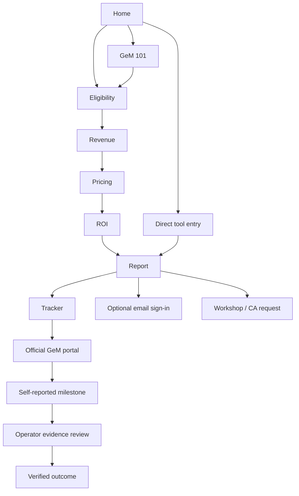
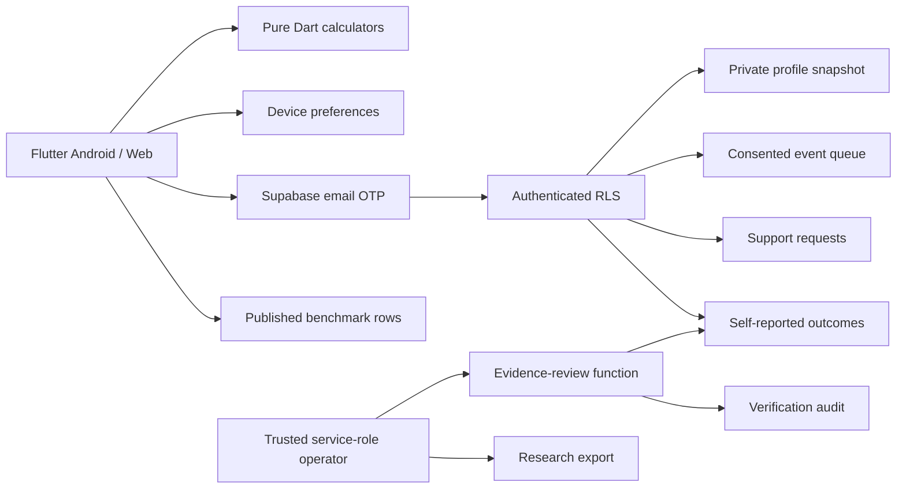

# GeM BizReady — Design and Architecture

Version 1.1 · 22 September 2026

## Experience direction
Calm, practical and independent. The new onboarding's black-and-white direction is the visual foundation for the entire product. The home page introduces a new buyer for an existing business, then offers eligibility or the basics. It avoids giant, unsourced procurement numbers. White surfaces, warm near-white canvas, charcoal type and restrained gray states keep financial tasks readable. The UI uses Flutter Material components with system-like typography, no stock photography and no heavy animation.

| Token | Value | Role |
|---|---|---|
| Canvas | `#FAFAF9` | Page background |
| Ink/primary | `#17191C` | Headings, actions and dark support panel |
| Muted | `#525963` | Supporting copy |
| Border | `#DDE0E3` | Quiet panel/input boundaries |
| Accent | `#F0F1F2` | Progress, next action and numbered markers |
| Cards | 20 px radius / 24 px padding | Reusable panels |
| Inputs/buttons | 10–12 px radius / ≥48 px action height | Touch interaction |
| Content | 1200 px outer max | Desktop readability |

## Responsive layout
Below 1180 px, the header uses a drawer and persistent language toggle; phones also show a four-destination bottom bar (Home, Tools, GST, Report). Desktop shows the main links and save action. Tool cards use 1/2/3 columns based on available width; forms/results stack below 700 px. The hero splits at 780 px. Content scrolls vertically, text is selectable and numeric fields use number keyboards. Form errors appear inline; transient actions use snackbars. Result values are accompanied by labels and source notes, not colour alone. Primary touch controls meet the 44 px minimum target; onboarding can be skipped without losing access to tools.

English and Hindi copy is kept adjacent through `AppStore.t` / `tr`. Domain categories retain stable English IDs while display labels change. Currency uses Indian grouping and `₹`. Noto Sans Devanagari is bundled (SIL Open Font License) so Hindi does not require a runtime font download; validate rendering on target Android devices. Technical operator data (metric IDs, exported JSON input keys and audit references) is not fully localised. A future content-management release can extract string pairs to ARB without changing the financial model.

## User flow

“No login needed” applies to calculators and local reports. Email sign-in enables online restoration and submissions. Research consent and partner contact permission are separate controls. Report sharing is user-initiated. Nothing is silently sent to a CA.

## Flutter modules
| File | Responsibility |
|---|---|
| `lib/main.dart` | Optional Supabase bootstrap, locale/theme and routes |
| `lib/core/models.dart` | Pure classification, eligibility, pricing, revenue and ROI functions; source URLs |
| `lib/core/theme.dart` | Material theme and visual tokens |
| `lib/data/app_store.dart` | Local state, authenticated snapshots, consent/event queue and cloud operations |
| `lib/features/shell.dart` | Responsive navigation, footer and foreground engagement sampling |
| `lib/features/widgets.dart` | Panels, headings, stats, source links and next actions |
| `lib/features/tools.dart` | Validated input forms, calculations and result views |
| `lib/features/pages.dart` | Home, education, tracker, report, account, support and trust pages |
| `lib/features/onboarding_flow_*.dart` | Optional guided readiness journey with a persistent skip action |
| `lib/gst/invoice.dart` | Invoice extraction, validation, summaries and comparison parsing without Flutter |
| `lib/features/gst_pages.dart` | GST hub, invoice editor, return working paper, reconciliation and documents |

State uses `ChangeNotifier` and shared preferences. Business calculations do not import Flutter, making boundary tests straightforward. Navigator routes are consistent across platforms. Features do not require Supabase credentials to launch.

## Data and trust boundaries

### Tables and permissions
- `profiles`: own ID only; JSON report/input/checklist state and separate consent flag.
- `funnel_events`: own reads and consent-gated inserts. UUID primary key deduplicates retries. No client update/delete route.
- `support_requests`: own reads and inserts into allowed columns; clients cannot change operator status.
- `outcomes`: own reads and self-reported submissions only. Column-level grants prevent changing verification status/timestamp/note. Verified records cannot be revised by client upsert.
- `benchmarks`: public read of published rows only; operator writes.
- `research_assignments`: operator-only participant allocation and observation window.
- `verification_audit`: operator-only review history.
- `research_export`: operator-only view; no email/contact or raw business inputs. Includes only consented assigned participants.
- `gst_invoice_records`: per-user invoice JSON under RLS; no public reads. PDF files live in a separate private `gst-invoices` bucket under an authenticated user-ID prefix.

The service-role key is never an app setting. `review_outcome` is executable only by the service role. `delete_my_data` derives the caller from `auth.uid()` and cannot take another user's ID.

Invoice extraction executes in the client. Users inspect and correct draft fields before marking them reviewed. Saving a PDF online is a separate choice. The signed-in owner receives a time-limited URL when opening their saved PDF. Return totals are derived only from entered invoices and remain working figures; the official portal and authorised signatory control filing and payment. See [GST architecture](docs/gst-architecture.md) for the professional-reviewed integration sequence.

### Persistence and restoration
Guest and authenticated profiles use distinct local keys. On verified sign-in, a newer cloud snapshot is restored; local guest work seeds an empty account. Cloud restoration must succeed before writes can overwrite an existing profile. Writes are serialised, batched events are idempotent, and edits during a sync request trigger another pass. A failed network request leaves local data available. Deletion waits for an in-flight sync before clearing cloud/local data.

This is single-user snapshot synchronisation, not a CRDT. Two devices editing simultaneously can overwrite older snapshots; timestamps are client-generated. The account restoration rule is explicitly documented. Future concurrent collaboration would require server revisions and a conflict-resolution screen.

### Event contract
Each consented event has `id`, authenticated `user_id` on upload, ephemeral `session_id`, event name, page, first-touch referral, UTC occurrence, small properties object and rule version. Page/tool starts, completion, CTA, module completion, active engagement, tracker steps, registration intent, report export, support requests and self-reported milestones are distinct names.

Foreground/current-route engagement is sampled at 30-second intervals and capped at 30 seconds per event. It is approximate engagement, not a precise stopwatch. No background timer counts hidden app time. Local queue is capped at 1000 events; on overflow oldest entries are dropped. No cloud collection for unsigned guests; this is a documented selection and completeness limitation. Verification comes from the outcomes table, never from a client event name.

## Financial model design
All raw numbers must be finite and non-negative; margins are below 100%; revenue bounds must be ordered. Domain functions throw on invalid inputs and the UI catches errors earlier through form validation. Financial values remain doubles for planning, rendered as rounded rupees. They are not invoice/accounting precision amounts.

Upstream recalculation invalidates saved ROI. The combined report includes only completed tools, input snapshots, calculation timestamps and a rule version. It exports a readable UTF-8 `.txt` report rather than disconnected PDFs. Category evidence is shown separately from editable scenario assumptions; the UI never silently substitutes sampled bid values for expected earnings.

## Backend operations and deployment
Supabase SQL is versioned under `supabase/migrations`. The app reads build-time `SUPABASE_URL` and `SUPABASE_ANON_KEY` (accepts publishable key); `config/env.json` is ignored. Email OTP verification avoids platform deep-link callback complexity: configure the email template to include `{{ .Token }}`.

Static release output is `build/web`; serve over HTTPS on a Flutter-compatible static host. Android debug APK is for device evaluation; Play distribution needs an approved package ID, upload key and release signing. Existing platform scaffolding is retained. No public hosting, account provisioning or Play Store publishing is implied by local builds.

## Verification strategy
- Pure model tests: threshold edges, invalid numbers, fee exemption/cap, margin versus markup, revenue ordering and loss/no-payback cases.
- Store tests: restart persistence, consent withdrawal, dependency invalidation, deletion and malformed-storage recovery.
- Widget tests: mobile Hindi/English, desktop navigation, empty-input errors, all pages at narrow width.
- SQL smoke tests: schema application, cross-user isolation, GST invoice/PDF isolation, consent gate, privileged-column rejection and published-only reads.
- Release builds: web plus Android APK compilation.
- Manual live checklist after credentials: OTP delivery, separate-account isolation, restore on another device, request delivery into database, review RPC, deletion and report share targets.

## Known delivery boundaries
No live tender scraper, automatic earnings forecast, official seller verification API, direct GeM registration automation, outbound email delivery service, confirmed workshop inventory or operator dashboard is claimed. GST OCR for scanned PDFs, arbitrary official GSTR-2B export support, live GSTIN status, official return filing, challan generation and payment are not implemented. Operators use Supabase and the supplied SQL/research scripts. The first-load Flutter web runtime is larger than a plain HTML site; PDF text extraction adds a lazy PDF engine and the product cannot promise a tiny initial download. Offline local calculations work after launch; a complete offline-installable web cache is not configured.
