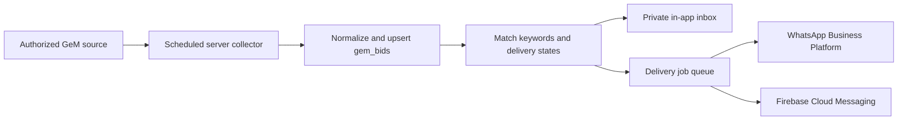

# Signup, GeM registration and bid alerts

## What changed in the app

The app journey is: animated logo → Welcome → language → **Bid2Scale signup/login and email verification** → GeM check → existing business/readiness onboarding → Home. Users with an active session skip signup/login. Returning signed-out users must log in before Home. GeM/readiness routes also require an authenticated session, so direct links do not bypass app registration. The logo reveal finishes in 750 ms, with a 1.2 second minimum launch hold and a 2.5 second ceiling for startup work; reduced motion removes movement.

The signup/login page uses passwordless email only, with explicit Sign up / Log in modes, autofill, inline validation, loading feedback, resend and change-email actions. Google signup is hidden until a later integration. Email signup collects an Indian WhatsApp number, normalized to `+91…`, with an optional alerts checkbox that starts off. Verification at the onboarding gate continues to the GeM question; the ordinary account page stays on the account view. If the alert-preferences RPC is unavailable, the phone details stay in the local profile and email login still succeeds. Signup's contact number is reused in business onboarding rather than requested twice. The demo phone-code screen is no longer routed in the normal app journey. WhatsApp numbers are collected but remain unverified until a provider is connected.

The design keeps the app's existing white, ink and forest-green tokens. Ink `#151515` on white has 18.3:1 contrast, secondary text `#5F6873` has 5.6:1, and green `#22654C` has 6.9:1. Forms use the existing 48 px minimum targets, a 560 px content limit, scrolling with keyboard avoidance, and system text scaling. The signature motion belongs to the existing arrow mark, rather than a new animation style. The new GeM guide is available from the account and Updates screens, and its checklist is saved as self-reported preparation.

Rendered previews: [mobile signup](screenshots/signup-mobile.png), [desktop signup](screenshots/signup-desktop.png), [GeM guide](screenshots/gem-guide-mobile.png). A repeated roadmap card was removed to shorten signup; the official-account distinction stays in a single caption. Larger text switches the signup/login selector into a vertical layout.

Design references read: [Launching › Best practices](../.agents/skills/apple-design/references/hig/launching.md) says “Launch instantly”; [Motion › Providing feedback](../.agents/skills/apple-design/references/hig/motion.md) says “Let people cancel motion”; [Managing accounts › Best practices](../.agents/skills/apple-design/references/hig/managing-accounts.md) says “Explain the benefits of creating an account and how to sign up.” The brief launch, guest exploration, responsive forms and contact disclosure apply these principles. Visual composition and wording are design judgments within the existing system.

## Live auth preflight — 22 October 2026

Read-only requests using the checkout's ignored `config/env.json` returned:

| Check | Observed result | Meaning |
| --- | --- | --- |
| Auth health | HTTP 200, GoTrue v2.197.0 | Project and public key respond |
| Email provider | Enabled | Email authentication is available |
| Signup | Allowed | New email accounts can be created |
| Email auto-confirm | Disabled | Email verification is required |
| Google provider | Disabled | Expected for the current email-only configuration; no Google button is shown |
| Core `benchmarks` endpoint | **HTTP 404** | App schema is missing from the exposed API or not exposed correctly |
| `bid_alert_preferences` endpoint | **HTTP 404** | New alert schema is not deployed |

This preflight does not prove SMTP delivery, receipt of an email code, a completed Google consent flow, redirect allowlists, or authenticated profile writes. No account was created and no email or WhatsApp message was sent. Repeat with `python3 scripts/check_auth.py`; it does not print credentials.

### Current email configuration and cloud saving

1. In the intended Supabase project, apply all three SQL files in timestamp order through migrations or the SQL editor:
   - `supabase/migrations/202609090001_initial.sql`
   - `supabase/migrations/202610130001_account_deletion.sql`
   - `supabase/migrations/202610220001_bid_alerts.sql`
   If a migration already exists, use the migration history instead of rerunning its `CREATE TABLE` statements. If tables already exist but the endpoint still returns 404, confirm that `public` is exposed to the Data API and reload its schema cache.
2. Keep Email enabled. In the **Magic Link email template**, show `{{ .Token }}`. The signup UI accepts 6–10 digit codes to accommodate the configured OTP length. Set up production SMTP and verify a code can actually be received and used. The default mail service may restrict who receives mail: see [Supabase custom SMTP](https://supabase.com/docs/guides/auth/auth-smtp).
3. Leave Google disabled for now. No Google credentials are required for the email-code flow.
4. Email-code verification happens inside the existing account page and does not require an OAuth callback. Existing mobile callback declarations are retained for a future Google integration.
5. Run with the configuration: `flutter run --dart-define-from-file=config/env.json`. A build without those defines intentionally has no online account connection. Never put the Google client secret, Supabase service-role key or WhatsApp token in this file.
6. Verify Welcome → language → signup → received code → GeM check; email login for an existing account; returning signed-out session → login → Home; direct GeM route → authentication required. Sign out and confirm a second user has no first-user data. Check expired codes and interrupted network. Unavailable app-data/alert tables affect saving, not whether a valid email code authenticates the account. Google can be configured later using the references below.

References: [Supabase Google setup](https://supabase.com/docs/guides/auth/social-login/auth-google), [Flutter OAuth](https://supabase.com/docs/reference/dart/auth-signinwithoauth), [email OTP](https://supabase.com/docs/guides/auth/auth-email-passwordless).

## WhatsApp OTP verification — proposed, not enabled

WhatsApp OTP is possible. [Supabase supports WhatsApp phone authentication through Twilio or Twilio Verify](https://supabase.com/docs/guides/auth/phone-login?showSmsProvider=Twilio). Email stays the active account-authentication method until the WhatsApp service is ready.

To verify a WhatsApp contact attached to an existing email account, the proposed implementation is:

1. Set up a WhatsApp Business Account and a registered business sender number, then connect it to a provider such as Twilio Verify. Twilio currently requires [your own WhatsApp sender](https://www.twilio.com/docs/verify/whatsapp/byo).
2. Obtain an approved WhatsApp authentication template and configure provider credentials and billing on the server. [Authentication templates require approval](https://www.twilio.com/docs/content/whatsappauthentication).
3. The signed-in user requests a code. An authenticated Supabase Edge Function starts a provider verification for that user's normalized number, with resend/attempt limits. Provider secrets stay on the server.
4. Another authenticated Edge Function checks the submitted code with the provider and records the exact verified number and verification time against the **same existing Supabase user ID**. Only the server can set verification status; changing a number clears it. Do not create a second phone-only account while trying to verify the email user's contact number.
5. Keep verification consent separate from bid-alert consent. Receiving a verification code must not automatically turn on bid notifications.

This contact-verification design is separate from replacing email with WhatsApp as the primary login method. The latter can use Supabase's supported phone-auth provider flow, but should be introduced only with an explicit account-linking/migration plan. No WhatsApp OTP endpoint, provider configuration, template or outgoing code has been activated in this change.

## Official GeM handoff

The saved guide explains preparation, Seller / Service Provider signup, identity/contact checks, seller profile completion, and bid readiness. The button opens [the official registration page](https://mkp.gem.gov.in/registration/signup#!/seller). PAN, Aadhaar, passwords and GeM OTPs belong on that portal. Returning from the browser or checking an item never marks the business as officially registered. Bid2Scale and GeM accounts remain separate. Current requirements on the official portal take precedence over the checklist.

## How bid collection and delivery work



### What is implemented

- The **Bids** tab reads open, published `gem_bids` records from Supabase, shows closing and collection times, and links back to GeM. It has loading, error, empty and refresh states. It does not substitute examples for a missing source. Home now links into this feed without claiming fabricated matches; Insights retains its labelled illustrative dataset.
- **Updates** saves product/service keywords, delivery states, a WhatsApp number and independent channel preferences. Any keyword can match; an empty keyword list means all bids. State names match exactly, ignoring case; an empty state list means all India. These are relevance filters, not eligibility certification.
- `bid_notifications` is a private, persistent inbox with read status. Refreshing Updates loads it; no realtime or background push service is claimed.
- A server-only `queue_bid_matches` RPC matches open bids, inserts inbox entries and queues opted-in WhatsApp jobs. Unique constraints prevent repeat imports from duplicating inbox entries or queue jobs. Preference updates cancel pending jobs for disabled channels. Account/data deletion removes preferences, inbox and jobs.
- `scripts/import_bids.py` validates an authorized JSON feed/export, deduplicates by source ID, upserts bids and calls the matcher. It defaults to dry-run. It is an ingestion bridge, **not a deployed GeM scraper or a delivery worker**.

Example normalized record (illustrative, never shipped as a live bid):

```json
[
  {
    "source_id": "YOUR_REAL_GEM_BID_ID",
    "title": "Office stationery supplies",
    "category": "Stationery",
    "buyer": "Actual buyer from source",
    "state": "Maharashtra",
    "closes_at": "2026-11-15T17:00:00+05:30",
    "source_url": "https://bidplus.gem.gov.in/ACTUAL_OFFICIAL_PATH"
  }
]
```

Validate with `python3 scripts/import_bids.py /path/to/bids.json`. On a trusted server only, provide `SUPABASE_URL` and `SUPABASE_SERVICE_ROLE_KEY` through its secret store and add `--apply` to import and queue. This command never sends notifications externally.

### What needs connecting before launch

1. **Collection source and scheduler.** Use an authorized feed/API if GeM provides one for this project, or a permitted collector of public bid listings. No public official bid API was confirmed during this work; the public bid-list page timed out in the research fetch. Validate access and the current page/data shape before writing the source adapter. A server job could poll every 15–30 minutes initially, with a cursor/overlap window, deduplication, bounded requests, backoff and source-health monitoring. Do not bypass login, CAPTCHA or access restrictions. A browser-rendered adapter can run in a server container if required; Flutter should only read normalized results. Fetch amended/closed bids too, so stale deadlines and cancelled bids are updated. Do not re-alert the whole archive on the first import; define a launch cutoff.
2. **WhatsApp delivery.** Connect a WhatsApp Business Platform sender (direct Meta Cloud API or your chosen provider), add its credentials only to the server, and obtain an approved bid-alert template. Suggested content: bid title, buyer/state, closing time, official link, and opt-out instructions. Check Meta's template category decision rather than assuming a utility classification. Outside the 24-hour customer service window, [WhatsApp requires approved templates](https://business.whatsapp.com/policy). The worker must recheck current consent, current number and bid availability immediately before every send; honor STOP/unsubscribe webhook events by updating the same preferences and cancelling pending jobs.
3. **Reliable workers and receipts.** Atomically claim pending jobs using `FOR UPDATE SKIP LOCKED`, mark a lease/attempt, and use bounded exponential retries with a dead-letter path. Serialize the final consent check against preference updates; a message already accepted by a provider cannot be recalled. Verify webhook signatures and persist provider message IDs and delivery/failure receipts. Queue uniqueness prevents duplicate jobs; delivery itself is not exactly-once unless the provider supports a suitable idempotency mechanism. Reconcile uncertain sends instead of blindly retrying them.
4. **Device push.** Create/configure Firebase for Android/web and APNs for iOS, add `firebase_messaging`, request permission when the user turns on phone notifications, and securely associate per-device tokens with the signed-in user. Add server-only push jobs and FCM HTTP v1 delivery, token refresh/revocation and notification-tap routing. [Firebase's Flutter setup](https://firebase.google.com/docs/cloud-messaging/flutter/get-started) describes the platform requirements. The current implementation supplies the in-app inbox; background/device push is not yet implemented, and the schema reserves a push channel without queuing it.
5. **Operational controls.** Add configurable delivery caps, quiet hours, per-channel delivery status and source freshness. Measure collector delay and send failures before choosing a shorter interval. All credentials and scheduled work live on the server so they work when the app is closed.

No collector, production schedule, WhatsApp sender, approved template, Firebase/APNs configuration or outgoing notification was deployed by this change.
